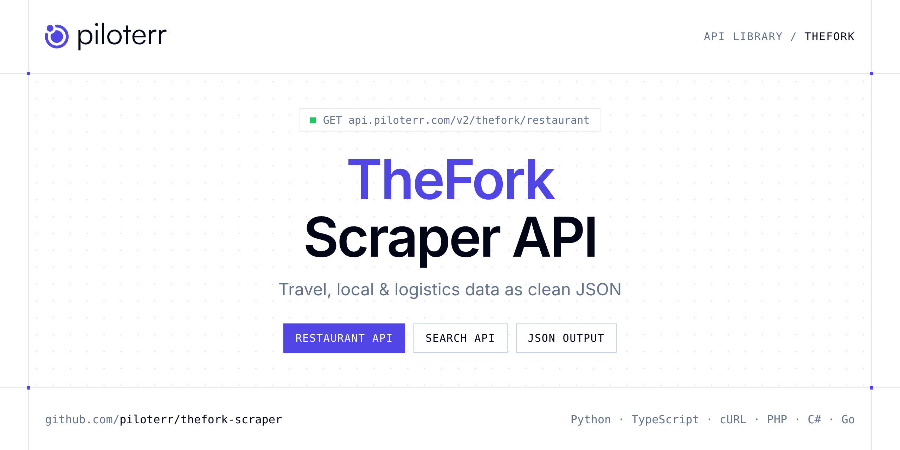

<p align="center">
  <a href="https://www.piloterr.com"></a>
</p>

# TheFork Scraper API

[](https://discord.gg/CFj3ph8aHU) [](https://app.piloterr.com) [](https://app.piloterr.com/openapi) [](LICENSE)

The **Piloterr TheFork Scraper API** lets you extract public data from TheFork as **clean, structured JSON** — no proxies, headless browsers or HTML parsing to maintain. Endpoints available in production:

- **TheFork Restaurant API** — Extract a full TheFork restaurant profile from a restaurant page URL, including ratings, tags, photo gallery, opening hours, and AI review summaries via browser rendering.
- **TheFork Search API** — Search TheFork restaurants from a full search or city URL and retrieve ratings, cuisine, prices, availability, review summaries, and pagination via browser rendering.

Use it for price tracking, review and reputation monitoring, local market research or logistics tracking.

| Endpoint | Path | Credits | What you get |
|---|---|---|---|
| [TheFork Restaurant API](#thefork-restaurant-api) | `/v2/thefork/restaurant` | 2 | Extract a full TheFork restaurant profile from a restaurant page URL, including ratings, tags, photo gallery, opening hours, and AI review summaries via browser rendering. |
| [TheFork Search API](#thefork-search-api) | `/v2/thefork/search` | 2 | Search TheFork restaurants from a full search or city URL and retrieve ratings, cuisine, prices, availability, review summaries, and pagination via browser rendering. |

## Table of contents

- [How it works](#how-it-works)
- [TheFork Restaurant API](#thefork-restaurant-api)
- [TheFork Search API](#thefork-search-api)
- [Code examples in other languages](#code-examples-in-other-languages)
- [Practical use cases](#practical-use-cases)
- [Why Piloterr?](#why-piloterr)
- [FAQ](#faq)
- [Official SDKs](#official-sdks)
- [Related scrapers](#related-scrapers)
- [Support](#support)

## How it works

1. **Create a free Piloterr account** and copy your API key from the [dashboard](https://app.piloterr.com).
2. **Send a `GET` (or `POST`) request** to `https://api.piloterr.com/v2/...` with the header `x-api-key: YOUR_API_KEY`.
3. **Receive structured JSON** — Piloterr handles rendering, proxies, retries and parsing.

```bash
export PILOTERR_API_KEY="your-api-key"
pip install requests        # Python
# TypeScript: Node.js 18+ (native fetch), run with `npx tsx file.ts`
```

> Every endpoint accepts both `GET` (query string) and `POST` (JSON body with the same fields).

## TheFork Restaurant API

Extract a full TheFork restaurant profile from a restaurant page URL, including ratings, tags, photo gallery, opening hours, and AI review summaries via browser rendering.

`GET | POST https://api.piloterr.com/v2/thefork/restaurant` · **2 credits per request** · [Full reference](https://app.piloterr.com/openapi)

### Request parameters

| Parameter | Type | Required | Description |
|---|---|---|---|
| `query` | string | ✅ | Full TheFork restaurant page URL. |

### Python example

```python
import json
import os
import requests

response = requests.get(
    "https://api.piloterr.com/v2/thefork/restaurant",
    headers={"x-api-key": os.environ["PILOTERR_API_KEY"]},
    params={
        "query": "https://www.thefork.fr/restaurant/salamboo-amilkar-r10892#date=2026-06-13&rankedBy=SEARCH_ENGINE",
    },
    timeout=120,
)
response.raise_for_status()
data = response.json()

print(json.dumps(data, indent=2, ensure_ascii=False)[:2000])
```

### TypeScript example

```typescript
type TheforkRestaurant = {
  id?: number;
  url?: string;
  name?: string;
  slug?: string;
  tags?: {
    id?: string;
    name?: string;
    category?: {
      id?: string;
    };
    is_published?: boolean;
  }[];
  uuid?: string;
  image?: string;
  images?: string[];
  address?: {
    street?: string;
    country?: string;
    locality?: string;
    zip_code?: string;
  };
  cuisine?: string;
  ratings?: {
    thefork?: {
      rating?: number;
      reviews_count?: number;
    };
    tripadvisor?: {
      rating?: number;
      reviews_count?: number;
    };
  };
  currency?: string;
  avg_price?: number;
  description?: unknown;
  geolocation?: {
    latitude?: number;
    longitude?: number;
  };
  is_bookable?: boolean;
  reviews_summary?: string;
  opening_time_information?: {
    opening_hours?: {
      fri?: Record<string, unknown>[];
      mon?: Record<string, unknown>[];
      sat?: Record<string, unknown>[];
      sun?: unknown[];
      thu?: Record<string, unknown>[];
      tue?: Record<string, unknown>[];
      wed?: Record<string, unknown>[];
    };
  };
};

const params = new URLSearchParams({
  "query": "https://www.thefork.fr/restaurant/salamboo-amilkar-r10892#date=2026-06-13&rankedBy=SEARCH_ENGINE",
});

const response = await fetch(`https://api.piloterr.com/v2/thefork/restaurant?${params}`, {
  headers: { "x-api-key": process.env.PILOTERR_API_KEY! },
});
if (!response.ok) throw new Error(`Piloterr error ${response.status}: ${await response.text()}`);

const data = (await response.json()) as TheforkRestaurant;

console.log(JSON.stringify(data, null, 2).slice(0, 2000));
```

<details>
<summary><b>POST variant</b></summary>

```http
POST https://api.piloterr.com/v2/thefork/restaurant
x-api-key: YOUR_API_KEY
Content-Type: application/json

{"query": "https://www.thefork.fr/restaurant/salamboo-amilkar-r10892#date=2026-06-13&rankedBy=SEARCH_ENGINE"}
```
</details>

### Output example

Example response from the API reference, abridged — real values depend on the page you scrape.

```json
{
  "id": 668497,
  "url": "https://www.thefork.fr/restaurant/le-petit-casa-r668497",
  "name": "Le Petit Casa",
  "slug": "le-petit-casa",
  "tags": [
    {
      "id": "1829",
      "name": "Bas-Rhin (67)",
      "category": {
        "id": "21"
      },
      "is_published": true
    },
    {
      "id": "5779",
      "name": "Carte Cadeau",
      "category": {
        "id": "11"
      },
      "is_published": true
    }
  ],
  "uuid": "265f611d-cb85-4ae4-a779-e963df820a4b",
  "image": "https://cdn.thefork.com/tf-lab/image/upload/restaurant/265f611d-cb85-4ae4-a779-e963df820a4b/b9c443c8-06c8-4d56-8e87-419c66f7eeee.jpg",
  "images": [
    "https://cdn.thefork.com/tf-lab/image/upload/restaurant/265f611d-cb85-4ae4-a779-e963df820a4b/b9c443c8-06c8-4d56-8e87-419c66f7eeee.jpg",
    "https://cdn.thefork.com/tf-lab/image/upload/restaurant/265f611d-cb85-4ae4-a779-e963df820a4b/e69b12cc-a28a-4d17-b6ff-1a32c51c94ce.jpg"
  ],
  "address": {
    "street": "24 Rue Thiergarten",
    "country": "France",
    "locality": "Strasbourg",
    "zip_code": "67000"
  },
  "cuisine": "Marocain",
  "ratings": {
    "thefork": {
      "rating": 9.8,
      "reviews_count": 1030
    },
    "tripadvisor": {
      "rating": 4.8,
      "reviews_count": 53
    }
  },
  "currency": "EUR",
  "avg_price": 35,
  "description": null,
  "geolocation": {
    "latitude": 48.5853087,
    "longitude": 7.7378558
  },
  "is_bookable": true,
  "reviews_summary": "Le Petit Casa enchante par son ambiance chaleureuse et dépaysante, évoquant un véritable voyage au Maroc. Les clients apprécient les plat…",
  "opening_time_information": {
    "opening_hours": {
      "fri": [
        {},
        {}
      ],
      "mon": [
        {},
        {}
      ],
      "sat": [
        {},
        {}
      ],
      "sun": [],
      "thu": [
        {},
        {}
      ],
      "tue": [
        {},
        {}
      ],
      "wed": [
        {},
        {}
      ]
    }
  }
}
```

### Response fields

| Field | Type | Description |
|---|---|---|
| `id` | integer |  |
| `url` | string |  |
| `name` | string |  |
| `slug` | string |  |
| `tags[]` | object[] |  |
| `tags[].id` | string |  |
| `tags[].name` | string |  |
| `tags[].category` | object |  |
| `tags[].is_published` | boolean |  |
| `uuid` | string |  |
| `image` | string |  |
| `images` | string[] |  |
| `address` | object |  |
| `address.street` | string |  |
| `address.country` | string |  |
| `address.locality` | string |  |
| `address.zip_code` | string |  |
| `cuisine` | string |  |
| `ratings` | object |  |
| `ratings.thefork` | object |  |
| `ratings.tripadvisor` | object |  |
| `currency` | string |  |
| `avg_price` | integer |  |
| `description` | object |  |
| `geolocation` | object |  |

## TheFork Search API

Search TheFork restaurants from a full search or city URL and retrieve ratings, cuisine, prices, availability, review summaries, and pagination via browser rendering.

`GET | POST https://api.piloterr.com/v2/thefork/search` · **2 credits per request** · [Full reference](https://app.piloterr.com/openapi)

### Request parameters

| Parameter | Type | Required | Description |
|---|---|---|---|
| `query` | string | ✅ | Full TheFork search or city listing URL. |

### Python example

```python
import json
import os
import requests

response = requests.get(
    "https://api.piloterr.com/v2/thefork/search",
    headers={"x-api-key": os.environ["PILOTERR_API_KEY"]},
    params={
        "query": "https://www.thefork.fr/search?cityId=529135&date=2026-06-13&hour=660&partySize=8&timezone=Europe%2FParis",
    },
    timeout=120,
)
response.raise_for_status()
data = response.json()

print(json.dumps(data, indent=2, ensure_ascii=False)[:2000])
```

### TypeScript example

```typescript
type TheforkSearch = {
  results?: {
    id?: number;
    url?: string;
    name?: string;
    slug?: string;
    uuid?: string;
    image?: string;
    rating?: number;
    address?: string;
    cuisine?: string;
    currency?: string;
    avg_price?: number;
    timeslots?: unknown[];
    geolocation?: {
      latitude?: number;
      longitude?: number;
      __typename?: string;
    };
    is_bookable?: boolean;
    reviews_count?: number;
    review_snippets?: {
      text?: string;
      __typename?: string;
      highlights?: Record<string, unknown>[];
      review_snippet_uuid?: string;
    }[];
    reviews_summary?: string;
  }[];
  pagination?: {
    next?: number;
    current?: number;
    next_url?: string;
    per_page?: number;
    total_count?: number;
    total_pages?: number;
    has_next_page?: boolean;
  };
};

const params = new URLSearchParams({
  "query": "https://www.thefork.fr/search?cityId=529135&date=2026-06-13&hour=660&partySize=8&timezone=Europe%2FParis",
});

const response = await fetch(`https://api.piloterr.com/v2/thefork/search?${params}`, {
  headers: { "x-api-key": process.env.PILOTERR_API_KEY! },
});
if (!response.ok) throw new Error(`Piloterr error ${response.status}: ${await response.text()}`);

const data = (await response.json()) as TheforkSearch;

console.log(JSON.stringify(data, null, 2).slice(0, 2000));
```

<details>
<summary><b>POST variant</b></summary>

```http
POST https://api.piloterr.com/v2/thefork/search
x-api-key: YOUR_API_KEY
Content-Type: application/json

{"query": "https://www.thefork.fr/search?cityId=529135&date=2026-06-13&hour=660&partySize=8&timezone=Europe%2FParis"}
```
</details>

### Output example

Example response from the API reference, abridged — real values depend on the page you scrape.

```json
{
  "results": [
    {
      "id": 423365,
      "url": "https://www.thefork.fr/restaurant/le-vintage-r423365",
      "name": "Le Vintage",
      "slug": "le-vintage",
      "uuid": "a55fe916-811b-43be-9b14-4babd77b0df9",
      "image": "https://cdn.thefork.com/tf-lab/image/upload/restaurant/a55fe916-811b-43be-9b14-4babd77b0df9/54b4e261-50d9-4bbb-a690-08a38059391c.jpg",
      "rating": 9.5,
      "address": "15 Rue des Serruriers, 67000, Strasbourg, France",
      "cuisine": "Alsacien",
      "currency": "EUR",
      "avg_price": 32,
      "timeslots": [],
      "geolocation": {
        "latitude": 48.5803126,
        "longitude": 7.7464058,
        "__typename": "Coordinate"
      },
      "is_bookable": true,
      "reviews_count": 571,
      "review_snippets": [
        {}
      ],
      "reviews_summary": "Le Vintage charme par son ambiance rétro et intimiste, avec une décoration vintage de très bon goût, agrémentée de photos d’actrices myth…"
    },
    {
      "id": 832121,
      "url": "https://www.thefork.fr/restaurant/restaurant-et-cafe-aygui-r832121",
      "name": "RESTAURANT ET CAFÉ AYGUI",
      "slug": "restaurant-et-cafe-aygui",
      "uuid": "d34ce798-5ed7-4a0f-b014-eb2dbdd24476",
      "image": "https://cdn.thefork.com/tf-lab/image/upload/restaurant/d34ce798-5ed7-4a0f-b014-eb2dbdd24476/d524634e-094b-447f-bdc8-c2865bf506e3.png",
      "rating": 9.3,
      "address": "5 Rue du Faubourg-de-Saverne, 67000, Strasbourg, France",
      "cuisine": "Arménien",
      "currency": "EUR",
      "avg_price": 18,
      "timeslots": [],
      "geolocation": {
        "latitude": 48.584737,
        "longitude": 7.740534999999999,
        "__typename": "Coordinate"
      },
      "is_bookable": true,
      "reviews_count": 202,
      "review_snippets": [
        {}
      ],
      "reviews_summary": "RESTAURANT ET CAFÉ AYGUI offre une belle découverte culinaire avec une cuisine caucasienne savoureuse et généreuse, notamment les délicie…"
    }
  ],
  "pagination": {
    "next": 2,
    "current": 1,
    "next_url": "https://www.thefork.fr/search?cityId=529135&date=2026-06-13&hour=660&partySize=8&timezone=Europe%2FParis#list25",
    "per_page": 25,
    "total_count": 185,
    "total_pages": 8,
    "has_next_page": true
  }
}
```

### Response fields

| Field | Type | Description |
|---|---|---|
| `results[]` | object[] |  |
| `results[].id` | integer |  |
| `results[].url` | string |  |
| `results[].name` | string |  |
| `results[].slug` | string |  |
| `results[].uuid` | string |  |
| `results[].image` | string |  |
| `results[].rating` | number |  |
| `results[].address` | string |  |
| `results[].cuisine` | string |  |
| `results[].currency` | string |  |
| `results[].avg_price` | integer |  |
| `results[].timeslots` | any[] |  |
| `results[].geolocation` | object |  |
| `results[].is_bookable` | boolean |  |
| `results[].reviews_count` | integer |  |
| `results[].review_snippets[]` | object[] |  |
| `results[].reviews_summary` | string |  |
| `pagination` | object |  |
| `pagination.next` | integer |  |
| `pagination.current` | integer |  |
| `pagination.next_url` | string |  |
| `pagination.per_page` | integer |  |
| `pagination.total_count` | integer |  |
| `pagination.total_pages` | integer |  |

## Code examples in other languages

Ready-to-run examples live in the [`examples/`](examples) folder. Each one reads your key from the `PILOTERR_API_KEY` environment variable.

| Language | Restaurant | Search |
|---|---|---|
| cURL (Bash) | [`restaurant`](examples/curl/restaurant.sh) | [`search`](examples/curl/search.sh) |
| PHP | [`restaurant`](examples/php/restaurant.php) | [`search`](examples/php/search.php) |
| C# | [`restaurant`](examples/csharp/Restaurant.cs) | [`search`](examples/csharp/Search.cs) |
| Go | [`restaurant`](examples/go/restaurant.go) | [`search`](examples/go/search.go) |
| Java | [`restaurant`](examples/java/RestaurantExample.java) | [`search`](examples/java/SearchExample.java) |
| Ruby | [`restaurant`](examples/ruby/restaurant.rb) | [`search`](examples/ruby/search.rb) |
| Node.js | [`restaurant`](examples/nodejs/restaurant.mjs) | [`search`](examples/nodejs/search.mjs) |

## Practical use cases

- **Price tracking** — Monitor rates and offers over time.
- **Reputation monitoring** — Track ratings and reviews of venues and competitors.
- **Local market research** — Map businesses, venues and events by area.
- **Logistics visibility** — Follow shipments and statuses where available.
- **Travel products** — Power comparison tools and alerts with structured data.

## Why Piloterr?

- **No infrastructure** — no proxies, headless browsers or CAPTCHA solving to run yourself.
- **Structured JSON** — stable, documented fields instead of brittle HTML selectors.
- **Pay per request** — transparent credit cost per endpoint, failed requests are retried for you.
- **One API key, hundreds of sources** — TheFork plus many other e-commerce, search and company data endpoints in the [Piloterr library](https://www.piloterr.com/library).
- **Any language** — plain HTTPS + JSON, with examples for Python, TypeScript, cURL, PHP, C#, Go, Java, Ruby and Node.js.

## FAQ

### Is it legal to scrape TheFork?

Collecting publicly available data is generally allowed in many jurisdictions, but rules depend on your country, the data you collect and how you use it. Avoid personal data unless you have a lawful basis, respect the website's terms where they apply, and get legal advice for your specific use case. This is not legal advice.

### Do I need proxies or a headless browser?

No. Piloterr handles rendering, proxy rotation and retries on its side. You only send an HTTPS request with your `x-api-key` header and receive JSON.

### How much does a request cost?

Credits per call: `/v2/thefork/restaurant` **2**, `/v2/thefork/search` **2**. See the [Piloterr website](https://www.piloterr.com) for plans.

### What data does the TheFork API return?

Each endpoint returns structured JSON: **TheFork Restaurant** — `id`, `url`, `name`, `slug`, `tags[]`, `tags[].id`; **TheFork Search** — `results[]`, `results[].id`, `results[].url`, `results[].name`, `results[].slug`, `results[].uuid`.

### Which languages are supported?

Any language that can make an HTTP request. This README shows Python and TypeScript; the [`examples/`](examples) folder contains cURL, PHP, C#, Go, Java, Ruby and Node.js.

## Official SDKs

Use Piloterr from your own language with a typed client:

| SDK | Package | Install |
| --- | --- | --- |
| Node.js | [`@piloterr/sdk`](https://www.npmjs.com/package/@piloterr/sdk) | `npm install @piloterr/sdk` |
| Python | [`piloterr`](https://pypi.org/project/piloterr/) | `pip install piloterr` |
| Go | [`piloterr-go`](https://pkg.go.dev/github.com/piloterr/piloterr-go) | `go get github.com/piloterr/piloterr-go` |
| .NET | [`Piloterr`](https://www.nuget.org/packages/Piloterr) | `dotnet add package Piloterr` |
| Ruby | [`piloterr`](https://rubygems.org/gems/piloterr) | `gem install piloterr` |
| PHP | [`piloterr/sdk`](https://packagist.org/packages/piloterr/sdk) | `composer require piloterr/sdk` |
| Java | [`piloterr-java`](https://github.com/piloterr/piloterr-java) | build from source, see its README |
| CLI | [`@piloterr/cli`](https://www.npmjs.com/package/@piloterr/cli) | `npm install -g @piloterr/cli` |
| MCP server | [`@piloterr/mcp`](https://www.npmjs.com/package/@piloterr/mcp) | `npx -y @piloterr/mcp` |

## Related scrapers

- [Auto Europe Scraper API](https://github.com/piloterr/autoeurope-scraper)
- [Eventbrite Scraper API](https://github.com/piloterr/eventbrite-scraper)
- [Expedia Scraper API](https://github.com/piloterr/expedia-scraper)
- [Maersk Scraper API](https://github.com/piloterr/maersk-scraper)
- [Yelp Scraper API](https://github.com/piloterr/yelp-scraper)
- [All Piloterr scrapers on GitHub](https://github.com/piloterr)

## Support

- 💬 Join the [Piloterr Discord](https://discord.gg/CFj3ph8aHU) to ask questions and share what you build.
- 📚 Browse the [API reference (OpenAPI)](https://app.piloterr.com/openapi) and the [Piloterr library](https://www.piloterr.com/library).
- 🔑 [Get your API key](https://app.piloterr.com).

---

<p align="center">
  <a href="https://www.piloterr.com">
    <picture>
      <source media="(prefers-color-scheme: dark)" srcset="images/logo-dark.svg">
      
    </picture>
  </a>
  <br>
  <sub>Built by <a href="https://www.piloterr.com">Piloterr</a> — web scraping APIs for e-commerce, search, real estate and more, one API key.</sub>
</p>

<sub>TheFork is a trademark of its respective owner. This repository is not affiliated with or endorsed by TheFork. Examples are released under the MIT license.</sub>
